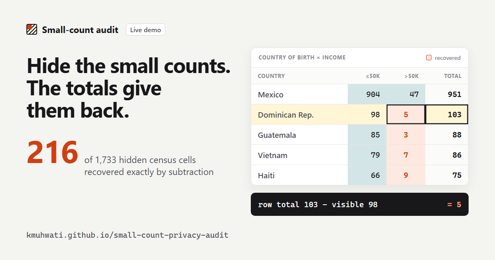
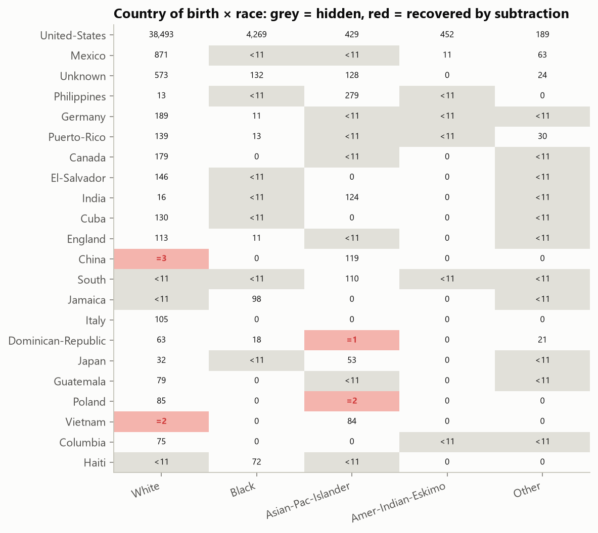
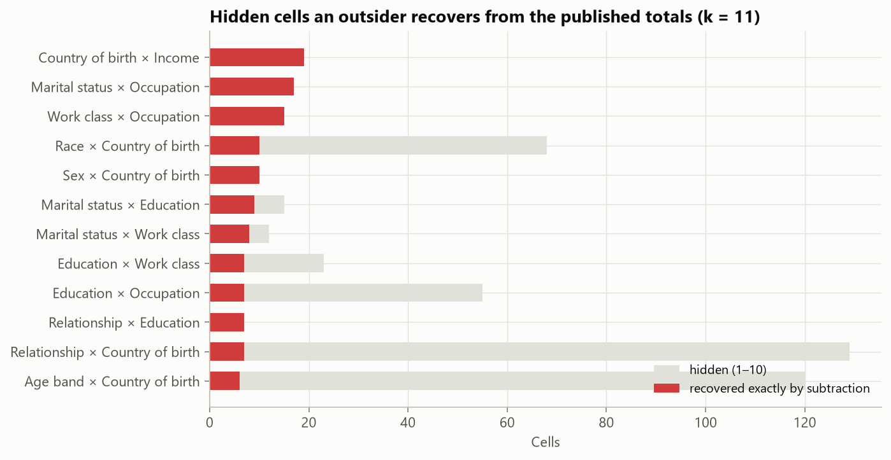
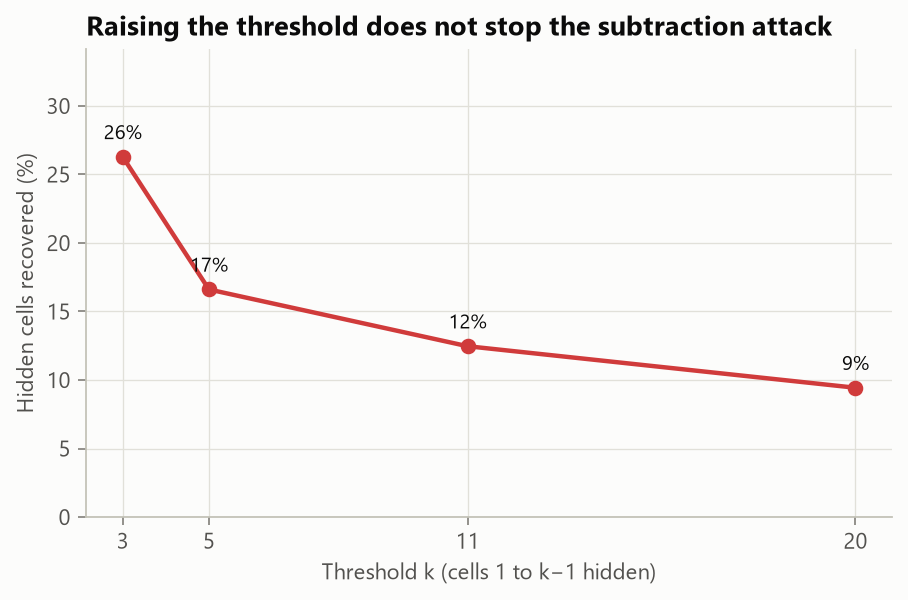
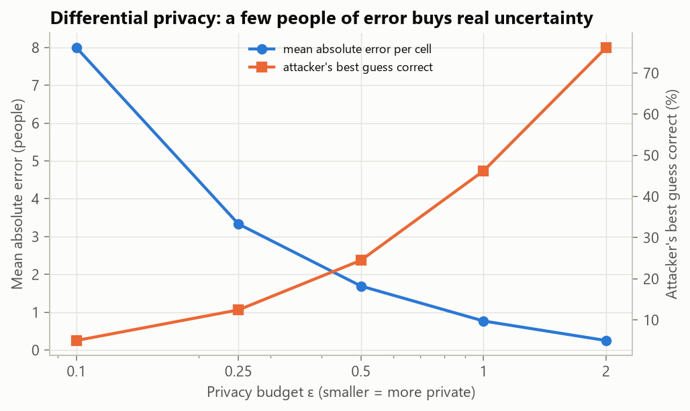

# Small-count suppression audit: how hidden cells leak, and what fixes it

**Live demo: [kmuhwati.github.io/small-count-privacy-audit](https://kmuhwati.github.io/small-count-privacy-audit/)**

[](https://kmuhwati.github.io/small-count-privacy-audit/)

   

Health agencies and statistics offices publish count tables with the small cells blanked out. The US Centers for Medicare & Medicaid Services, for example, hides any count from 1 to 10. The idea is that nobody can single out a person in a group that small. But the same tables also publish row and column totals, and a hidden cell that is the only blank in its row equals the row total minus the visible cells. This project measures how often that happens on real census data, tests the standard fix (complementary suppression), and compares both with differential privacy.

The dashboard lets anyone pick a table, move the threshold, and watch the attacker fill in the blanks step by step. It runs entirely in the browser on precomputed tables.



## Results at a glance

Data: UCI Adult (1994 US Census extract), **48,842 people**. Every two-way table over 11 attributes, giving **55 tables and 5,470 cells**. The threshold is k = 11, so counts of 1 to 10 are hidden.

| Measure | Value |
|---|---|
| Non-zero cells | 4,640 |
| Cells hidden by the 1–10 rule | 1,733 (37.3% of non-zero cells) |
| **Hidden cells recovered exactly by subtraction** | **216 (12.5%)** |
| Tables with at least one recovered cell | 39 of 55 |
| People in recovered cells | 953 |
| Extra cells complementary suppression hides | 210 (hidden share rises to 41.9%) |
| Cells recovered exactly after complementary suppression | 0 |
| Small cells still pinned to a range narrower than 1–10 (linear programming) | 314 |
| Differential privacy at ε = 1: mean absolute error per cell | 0.77 |

## What the audit shows

1. **The suppression rule alone leaks one hidden cell in eight.** The attack needs nothing but the published table. Whenever a row or column has exactly one hidden cell, that cell equals the total minus the rest. Filling it in can leave another line with a single blank, so the attack repeats until it gets stuck. Three tables give up every one of their hidden cells: native country by income, marital status by occupation, and workclass by occupation. Every recovered value is checked against the true count.

   

2. **Raising the threshold does not close the hole.** A stricter rule hides more cells, but the attacker still recovers about 200 of them at every threshold tried. The recovered share falls from 26% at k = 3 to 9% at k = 20 only because the number of hidden cells grows.

   | k | Cells hidden | Recovered | Share |
   |---|---|---|---|
   | 3 | 723 | 190 | 26.3% |
   | 5 | 1,108 | 184 | 16.6% |
   | 11 | 1,733 | 216 | 12.5% |
   | 20 | 2,173 | 205 | 9.4% |

   

3. **Complementary suppression stops exact recovery but still narrows the guess.** The fix hides extra cells so that no row or column has a single blank. A greedy pass that hides the smallest visible cell in each exposed line adds 210 cells, and subtraction then recovers nothing. An attacker can still set the table up as a linear program: every hidden cell is a non-negative whole number and every line must add up to its total. Solving for each cell's lowest and highest possible value leaves 314 of the originally small cells inside an interval narrower than the 1–10 range the rule promises. Hiding more cells protects better, but it is a patch on a method that has no guarantee.

4. **Differential privacy gives a guarantee and costs little at moderate ε.** Instead of hiding cells, every cell gets two-sided geometric (discrete Laplace) noise and is published in full. At ε = 1 the mean error is 0.77 people per cell, the 95th percentile error is 3, and the median relative error on cells of 11 or more is 0.04%. The chance that an attacker's best guess of any one cell is exactly right is tanh(ε/2), which is 46% at ε = 1 and 24% at ε = 0.5, however much side information they have. Totals stay consistent only if they are computed from the noisy cells, which is how the dashboard does it.

   | ε | Mean error | 95th pct error | Small cells within ±2 | Exact guess chance |
   |---|---|---|---|---|
   | 0.1 | 8.0 | 26 | 38.6% | 5.0% |
   | 0.25 | 3.3 | 11 | 58.3% | 12.4% |
   | 0.5 | 1.7 | 5 | 77.9% | 24.5% |
   | 1 | 0.77 | 3 | 94.3% | 46.2% |
   | 2 | 0.25 | 1 | 99.7% | 76.2% |

   

## The dashboard

[Open it here.](https://kmuhwati.github.io/small-count-privacy-audit/) The layout is a small analysis workbench: the table on the left, the settings and an inspector on the right. Choose any two attributes and a threshold, then switch between three methods:

* **Suppress small counts**: hidden cells are hatched. Cells the attacker recovers turn red with their true value. Click one and the inspector shows the subtraction, with the row or column it came from highlighted. The attack log under the table lists every step in order.
* **Add complementary cells**: the extra hidden cells are added and the attack runs again.
* **Differential privacy**: pick ε and draw new noise to see how far the published numbers move from the truth.

The browser code (`web/src/privacy.js`) is a port of the Python modules. Its tests run against fixtures written by the Python audit, so the dashboard and the report give the same answers.

## Method

| Step | Implementation |
|---|---|
| Tables | All 55 pairs of 11 attributes, with age and hours per week put into bands; "?" becomes "Unknown" |
| Primary suppression | Hide 1 ≤ count < k; zeros stay visible, as in most published rules |
| Attack | Repeated single-blank subtraction on rows and columns until nothing changes |
| Complementary suppression | Greedy: in any line with exactly one hidden cell, also hide its smallest visible cell; repeat until stable |
| Interval attack | `scipy.optimize.linprog` (HiGHS), minimising and maximising each hidden cell subject to the published totals |
| Differential privacy | Discrete Laplace noise as the difference of two geometric draws, clamped at 0, 25 repeats per ε |

## Limitations

* The attack uses only one table at a time. Real releases publish many overlapping tables, and linking them recovers more, so these numbers are a lower bound.
* The linear program relaxes cells to real numbers, so the intervals are slightly wider than an integer attacker would get.
* The greedy complementary suppression is simple. Production tools such as τ-ARGUS hide fewer extra cells at the same protection level.
* Clamping noisy counts at zero adds a small upward bias to cells whose true value is near zero.
* Adult is a 1994 extract, used here because it is public and well known. The method applies to any published count table.

## Reproduce

```bash
pip install -r requirements.txt
python scripts/download_data.py      # UCI Adult, about 4 MB
python scripts/run_audit.py          # audit, figures, reports/ and web/public/*.json
pytest -q

cd web
npm ci
npm test                             # JavaScript port against the Python fixtures
npm run dev                          # dashboard at http://localhost:5173
```

Every push to `main` runs both test suites, builds the dashboard and deploys it to GitHub Pages (`.github/workflows/ci.yml`).

## Structure

```
src/privaudit/
  data.py          load Adult, bands, two-way tables
  suppression.py   primary and complementary suppression
  attack.py        subtraction attack and linear-programming bounds
  dp.py            discrete Laplace noise
  audit.py         full audit, figures, report and dashboard data
scripts/           download_data.py, run_audit.py
tests/             known-answer tests on hand-made tables
reports/           metrics.json, RESULTS.md, tables/, figures/
web/               React + Vite dashboard; src/privacy.js is the browser port
```

## Data

UCI Machine Learning Repository, Adult dataset (Becker and Kohavi, 1996), licensed CC BY 4.0. The raw files are downloaded by the script and not stored in this repository.
